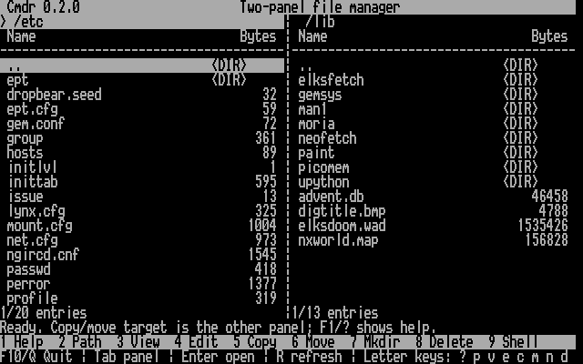
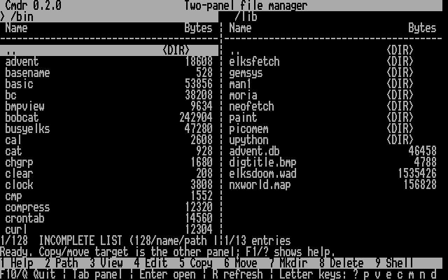
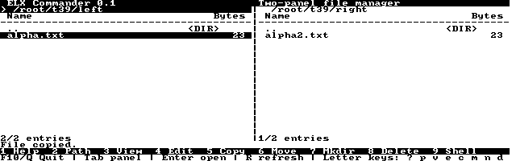

# cmdr

[Download 0.3.0](https://github.com/l00nix/ELKS-cmdr/releases/tag/v0.3.0) · [Integration status](integration/README.md) · [Discussions](https://github.com/l00nix/ELKS-cmdr/discussions)

A small two-panel ANSI file manager for [ELKS](https://github.com/ghaerr/elks).
The executable is **`cmdr`** (formerly `elxcmd` / ELX Commander).
It uses terminal interfaces rather than HP firmware, so it can run on other ELKS
machines with a suitable console or serial terminal.

## Development beta: 0.4.0-beta2

This branch imports the ELKS TUI sources following
[Ghaerr's suggested integration](https://github.com/ghaerr/elks/discussions/2859#discussioncomment-19877552).
The unchanged import is a separate commit, followed by cmdr integration and a
reviewable [patch to the imported sources](integration/elks-tui.patch).

- Beta2 adds the ELKS local-console function-key encoding missing in beta1;
  physical-keyboard confirmation of this fix is pending.
- Direct `1`–`9` command keys and `0` to quit; simpler help. Function keys and
  existing letter shortcuts remain available. Digits in path/name prompts are literal.
- Upstream TUI terminal setup and ANSI key decoding, with bounded waits for bare
  Escape, split sequences, and additional SS3/Linux-console function keys.
- Panels and the text viewer use detected terminal dimensions, from 80×25 up to
  250×100. Detection uses the terminal ioctl or ANSI DSR; no response falls back
  to 80×25. `R` refreshes the terminal size as well as directory listings.
- Bracketed paste is ignored, preventing pasted text from executing panel commands.

The stable download and 8088retro EPT package remain **0.3.0**. Beta1 passed
physical PPC Telnet checks, including 209 entries per panel, size detection,
file operations and terminal restoration. The user confirmed the local display and other controls, but found function
keys inoperative in beta1. Beta2 retesting and HP checks remain pending; see [beta test results](docs/TESTING.md). Image-viewer
integration and CP437/Unicode borders are deferred; ASCII borders remain in use.

## Changes in 0.3.0

Directory panels now grow dynamically, with compact filename storage instead of
128 fixed slots. Capacity depends on available memory; an allocation failure or
unreadable/unsupported entry produces an explicit **INCOMPLETE LIST** warning.
The native build reserves a 48 KiB heap within its audited 64 KiB data segment.

Terminal input now uses the inherited stdin descriptor and `select()`, removing
the dependency on opening `/dev/tty` that prevented PPC Telnet startup.
Verified over Telnet on a physical PPC 512: both panels list all 206 `/bin`
entries, file operations and external-shell return work, and quit/Ctrl-C restore
the terminal. Host/emulator tests also cover 600-file directories; larger PPC
fixtures remain slow. See [validation details](docs/TESTING.md).
Upgrade an existing installation with `ept install cmdr` using the repository below.

## Screenshots

Cmdr 0.2.0 running on a physical Amstrad PPC 512 with ELKS 0.9.2,
captured on 21 November 2026. These images render the actual 80x25 console
video memory using the BIOS font read from the same machine. Scan lines are
doubled vertically for readability; they are not emulator or terminal mockups.





The second capture demonstrates the explicit incomplete-list warning for
`/bin`, which exceeds the 0.2.0 128-entry panel limit.
[Raw captures and provenance](docs/images/README.md).

### Earlier HP 200LX capture



ELX Commander 0.1 on the double-speed HP 200LX after a successful file copy,
captured with ELXcap on 19 October 2026.
The original 640×200 pixels are preserved. The displayed names and versions predate
the standalone rename. [Original BMP](docs/images/cmdr.bmp) ·
[Capture details](docs/images/README.md).

## Install with EPT

cmdr 0.3.0 is available in the **stable catalogue** of the
[8088retro EPT repository](http://ept.8088retro.com/).
With ELKS networking running and EPT installed, set the `REPO` line in
`/etc/ept.cfg` to the following (keep a copy of your previous configuration):

```ini
REPO=http://ept.8088retro.com
```

Then run as root:

```sh
ept update
ept install cmdr
TERM=ansi cmdr /etc /lib
```

Use plain `http://` for this vintage-client repository. No `-n` option is needed.
The package installs `/bin/cmdr`, `/lib/cmdr/copying` and `/lib/cmdr/usage.txt`.
Version 0.3.0 fixes full-screen Telnet startup as well as the fixed 128-entry
listing limit. Both local console and ANSI Telnet are supported; the UI needs
at least 80 columns and 25 rows. To upgrade just cmdr, run `ept install cmdr`
again. `ept upgrade` considers all installed packages.
The 0.2.0-to-0.3.0 EPT upgrade and installed Telnet UI were verified on the
physical PPC 512, including 206 entries in each panel. See
[validation details](docs/TESTING.md) for hardware results and limits.

If EPT is not installed yet, follow the repository's
[EPT bootstrap instructions](http://ept.8088retro.com/).
The [upstream EPT recipe PR](https://github.com/sammothxc/ept/pull/12) is separate
from this published 8088retro package and is still awaiting maintainer acceptance.

## Use

```sh
TERM=ansi cmdr /root /tmp
```

| Keys | Action |
| --- | --- |
| Tab | Switch panel |
| Arrows, Home/End, PgUp/PgDn | Select and scroll |
| Enter | Open a directory |
| 1 / F1 / ? | Help |
| 2 / F2 / P | Change panel path |
| 3 / F3 / V | View a file; Q returns to panels |
| 4 / F4 / E | Edit using vi |
| 5 / F5 / C | Copy selected file to other panel |
| 6 / F6 / M | Move selected file to other panel |
| 7 / F7 / N | Create a directory |
| 8 / F8 / D | Delete a file or empty directory |
| 9 / F9 / ! | Shell in active directory |
| R | Refresh listings |
| 0 / F10 / Q | Quit |

Copy, move and delete require confirmation. Copy/move refuse existing destinations.
Directory trees are not copied or moved recursively. Listings grow with available memory and report incomplete results. The beta UI uses detected terminal dimensions (minimum 80x25). No mouse or Nano-X is required.

## Build and install

Use a configured [ELKS source tree](https://github.com/ghaerr/elks) with its
IA16 compiler and matching libc installed:

```sh
ELKS=/path/to/elks sh build.sh
make install DESTDIR=/path/to/staging-root
```

The build targets the 8086 and audits the retained ELF, disassembly and near-memory
layout. Output is `build/cmdr`. Install paths are `/bin/cmdr` and
`/lib/cmdr/{copying,usage.txt,tuilic.txt}`; every installed component fits 8.3 naming.
The staging root must exist on the host; do not point it at an unintended filesystem.

[External build and EPT integration](integration/README.md) includes the package
recipe. The 8088retro package is published; deployment on the original EPT server remains a separate maintainer step.

## Tests and status

```sh
make test
```

Host tests require a C compiler and Python 3. On macOS, Cmdr's legacy formatted
output calls may need `CFLAGS='-O2 -Wall -Wextra -Werror -Wno-misleading-indentation -Wno-deprecated-declarations -Isrc'`.
Native builds are additionally checked with `elksemu`; synthetic memory fixtures
are not hardware captures. See [validation](docs/TESTING.md) for this release.

## Origins and license

Developed by [@l00nix](https://github.com/l00nix) with AI assistance, originally as part of the
[HP 200LX ELX suite](https://github.com/l00nix/HP-200LX-elx-suite).
The standalone source starts from suite commit `a2cc3f3`; historical suite releases
retain their original names. ELKS provides the operating system, libc and toolchain.
Project code is [GPL-2.0-or-later](COPYING). Imported ELKS TUI attribution and
[third-party notices](THIRD-PARTY.txt) are retained.

Inspired by Norton Commander and classic two-panel file managers; no Norton source
or binaries are included.
